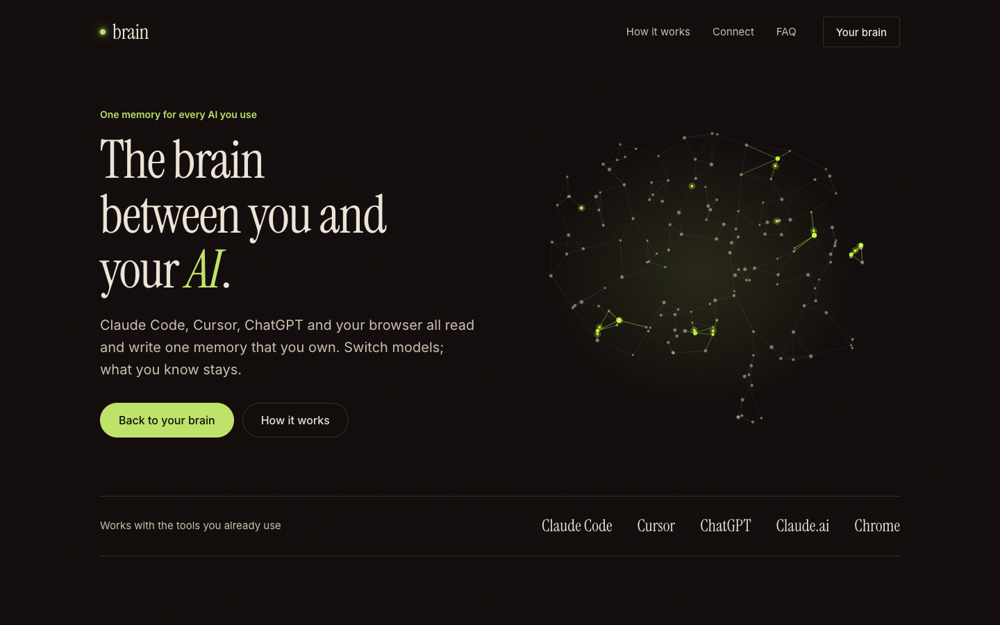
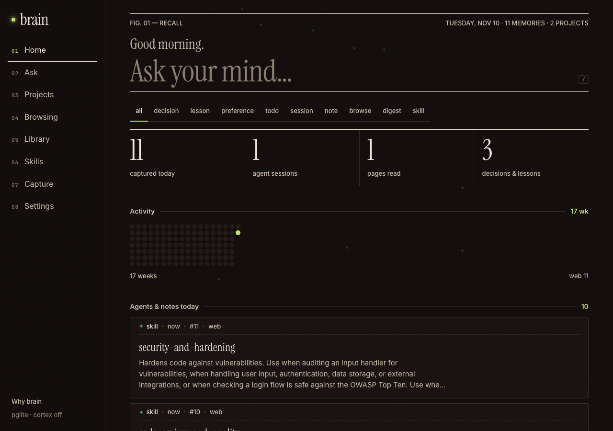
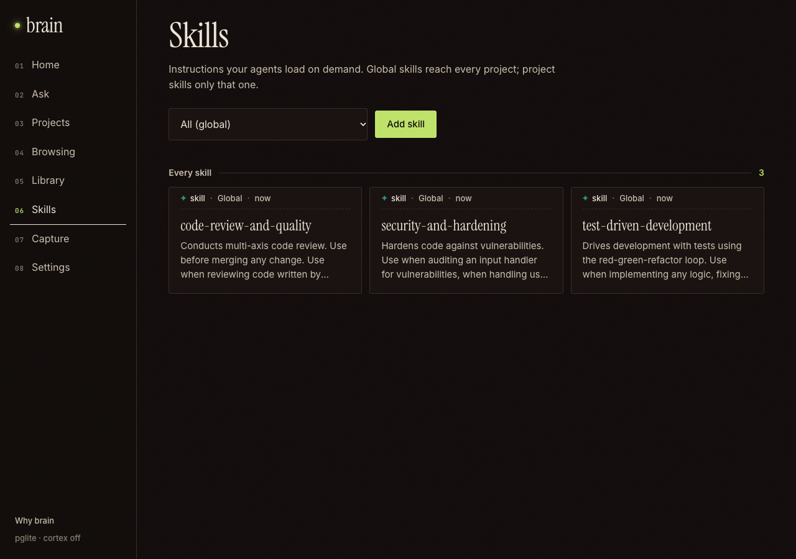
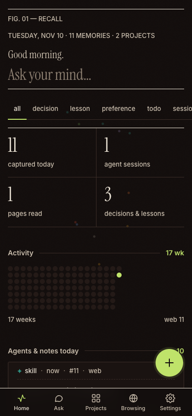

<div align="center">



# brain

**The brain that sits between you and your AI.**

One memory that every agent — Claude Code, Cursor, ChatGPT, Claude.ai, your browser — reads from and writes to.
Self-hosted. Yours. Switch models; what you know stays.

[Quick start](#quick-start) · [Connect your agents](#connect-your-agents) · [Skills](#skills) · [Self-host](#self-host) · [Contributing](CONTRIBUTING.md)

  

</div>

---

## Why

Every AI tool keeps its own little memory, locked inside its own product. Switch from one assistant to
another and you start from zero. Brain flips that: **your knowledge lives in one place you own**, and
every agent plugs into it over [MCP](https://modelcontextprotocol.io).

- **Agents brief themselves.** At the start of a session an agent gets who you are, how you like to
  work, the lessons it must not repeat, decisions already made and open threads for that project.
- **Agents write back without being asked.** Decisions, lessons, preferences and todos are saved the
  moment they happen; whole sessions are summarized when they end.
- **Skills travel with you.** Keep your `SKILL.md` playbooks in Brain, per project or global, and any
  agent can list and load them.
- **Your reading, compacted.** The Chrome extension keeps pages you actually read and folds each day
  into a digest.
- **Search that understands you.** Full-text search everywhere, plus semantic (vector) search with
  pgvector when an embeddings endpoint is configured.
- **Private by default.** Single owner token, secrets redacted before storage, one-click JSON export,
  runs on any Postgres.

## Screenshots

| Search your mind | Skills | Phone |
|---|---|---|
|  |  |  |

## How it works

```
 Claude Code ──hooks + MCP──┐          ┌── Web app / PWA (phone, desktop)
 Cursor, Codex, Windsurf ─MCP┤          ├── Chrome extension
 ChatGPT / Claude.ai ──OAuth─┼─ brain ──┤
 iOS Shortcut, CLI ───REST───┘  server  ├── Postgres  (full-text + pgvector)
                                        └── optional: embeddings, object-storage backups
```

A small Hono server exposes a REST API, an MCP endpoint (`/mcp`) and the web app. Everything is a
**memory** (`kind`: session, decision, lesson, preference, todo, fact, skill, browse, digest…) in one
Postgres table.

## Quick start

```bash
git clone https://github.com/sshivanshg/brain && cd brain
npm run setup          # installs deps, enables git hooks
npm start              # http://localhost:4321 with embedded Postgres (PGlite) in ./data
cat data/token.txt     # your access token — paste it into the web app
```

Requires Node 24 (see `.nvmrc`). No database needed locally.

## Connect your agents

```bash
npm run connect -- --url http://localhost:4321 --token <token>
```

This registers the `brain` MCP server for Claude Code and Cursor, adds Claude Code hooks
(SessionStart / SessionEnd / PreCompact / UserPromptSubmit) and a short protocol block in
`~/.claude/CLAUDE.md`. Every file it touches is backed up first, and re-running is safe.

**Any other MCP client** (Codex, Windsurf, Claude Desktop…): add an HTTP MCP server at
`<your-brain>/mcp` with header `Authorization: Bearer <token>`.

**ChatGPT / Claude.ai:** add a custom connector pointing at `<your-brain>/mcp`; Brain speaks OAuth 2.1
(PKCE + dynamic client registration) and asks for your token once.

MCP tools: `brief`, `remember`, `recall`, `get`, `update`, `forget`, `timeline`, `projects`,
`update_profile`, `dream`, `save_digest`, `skills`, `skill`, `save_skill`.

## Skills

Store the playbooks you build with — your own or imported — and every agent can use them.

```bash
brain skill add ./SKILL.md -p my-app            # one file, for one project
brain skill add ./.claude/skills                # a whole folder, global
brain skill add https://github.com/org/repo/tree/main/skills/tdd   # import from GitHub
brain skills -p my-app                          # list
brain skills pull -p my-app                     # write them into ./.claude/skills/<name>/SKILL.md
```

Agents see the skill list in their briefing, load one with the `skill` tool and save new ones with
`save_skill`. You can also add, import and read skills in the web app under **Skills**.

## CLI

```bash
brain                  # briefing for this project + today so far
brain find <query>     # search everything
brain add "…" -k decision -p my-app
brain today | yesterday
brain handoff "…"      # note for the next agent session here
```

Link it with `npm link` or `ln -s "$PWD/bin/brain.mjs" ~/.local/bin/brain`.

## Chrome extension

`chrome://extensions` → Developer mode → **Load unpacked** → `extension/`, then enter your brain URL
and token. Pages count after 20s of focused reading; banking, email and password managers are blocked
by default; incognito is never captured.

## Self-host

Brain is a plain Node server plus Postgres, so it runs anywhere.

| Variable | |
|---|---|
| `DATABASE_URL` | Any Postgres (Neon, Supabase, RDS, local). Schema is created on boot; pgvector is enabled if available. |
| `BRAIN_TOKEN` | Required in production. `openssl rand -base64 32` |
| `BRAIN_TZ` | IANA timezone for "today" (default: server timezone) |
| `NEON_AI_GATEWAY_BASE_URL` / `_TOKEN` | Optional OpenAI-compatible embeddings for semantic search |
| `AWS_*`, `BRAIN_BUCKET` | Optional S3-compatible storage for daily JSON backups |
| `ANTHROPIC_API_KEY` | Optional: server-side summaries, digests and answers |

**Neon (one URL for API, MCP and app):** `neon.ts` describes Postgres, Auth, object storage,
Functions and the AI Gateway. `npm run deploy` bundles the web app and deploys it as a Neon Function.

**Anything else:** `npm start` on Node 24 behind HTTPS, or the included `Dockerfile`.

## API

All routes need `Authorization: Bearer <token>`.

| Route | |
|---|---|
| `GET /api/memories?q=&kind=&project=&day=` | search or list |
| `POST /api/memories` | `{kind, content, title?, project?, tags?, url?}` |
| `GET / PATCH / DELETE /api/memories/:id` | read, edit, archive |
| `GET /api/skills?project=` · `GET /api/skills/:name` · `POST /api/skills` | skills |
| `POST /api/capture` | quick note or link |
| `GET /api/brief?project=` | the briefing agents get |
| `GET /api/export` | everything as JSON |
| `POST /mcp` | MCP (Streamable HTTP) |

## Develop

```bash
npm run dev       # restart on change
npm run check     # syntax, design-token lint, manifests, tests
```

Read [AGENTS.md](AGENTS.md) and [CONTRIBUTING.md](CONTRIBUTING.md) first. UI follows
[docs/DESIGN.md](docs/DESIGN.md).

## License

[AGPL-3.0](LICENSE). If you run a modified Brain as a service for others, share your changes.
